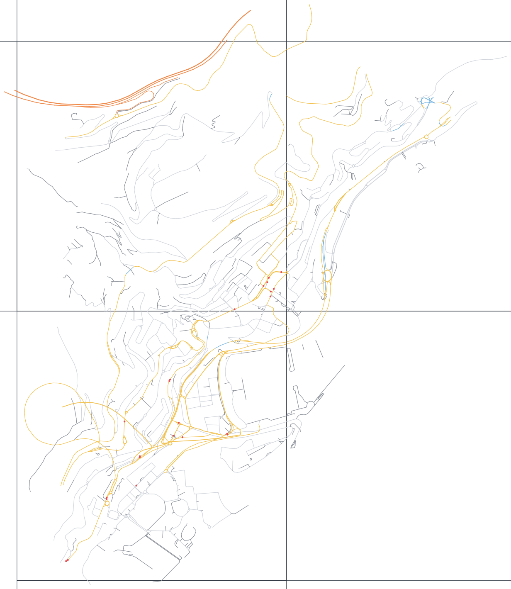

# The whole Earth, at full scale

The game world can be the real planet at 1:1. This page says what that means in practice, what is tested, how to set it up in Unreal, and where the limits are.



*Monaco, converted from OpenStreetMap by `Tools/osm_to_tiles.py`. Orange is motorway, yellow main roads, red dots traffic signals, grid lines tile borders.*

## Who supplies what

No project builds the Earth by hand. Full-Earth games stream it, and so does this one.

| Part of the world | Where it comes from | In this repository? |
|---|---|---|
| Terrain, satellite imagery, 3D buildings | A streaming service through the **Cesium for Unreal** plugin: Cesium ion (terrain, imagery, OpenStreetMap buildings) or Google Photorealistic 3D Tiles | No. Needs the plugin, an account, an internet connection while playing, and their licence terms |
| Roads the game can drive on | OpenStreetMap, converted to tiles by `Tools/osm_to_tiles.py` | The converter, and a sample for Monaco |
| Traffic, police, heat, missions, economy, saves anywhere on the globe | The simulation in `Source/Undertow/Sim` | Yes, tested |
| Hand-built places | Regions such as Port Meridian, pinned to a latitude and longitude | Yes |

Expect streamed scenery to look like a mapping app from the air and rough at street level: flat textures, melted trees, no interiors. That is the nature of the source data. The usual answer is to build the places that matter by hand as regions and let the streamed planet be everything in between.

## What is tested and what is not

**Tested here (64 C++ cases, 22 Python, clean under sanitizers):**

- Latitude/longitude maths to the millimetre anywhere, including the date line and the far north
- Road tiles loading and unloading around a moving player, with memory staying flat
- A 42 km drive across 28 tiles with 27 origin moves: traffic never dies out, nothing drifts
- A police chase that carries on through origin moves and tile changes
- Missions placed by latitude and longitude; saves that restore the right place on Earth
- Real data: Monaco converted from OpenStreetMap, 90% or more of it one connected network, routes found, traffic and police running on it
- Left-hand traffic

**Not tested, because there is no Unreal Engine here:**

- Everything in `Source/Undertow/Game`, including the Earth additions below
- Any of it running against Cesium. The steps below follow Cesium's documentation (version 2.31); names may differ in yours

## How it works

- A place on Earth is a latitude and longitude held in doubles.
- The simulation never works in those directly. It works in meters east and north of an **anchor** near the player, where ordinary floats are precise. When the player gets 1.5 km from the anchor, the anchor moves to the player and everything the simulation holds is re-expressed. Traffic, police and missions do not notice.
- Roads are cut into **tiles** on the same grid web maps use (zoom 14: about 1.5 km across at mid latitudes). Tiles within 1.2 km of the player are loaded; tiles beyond 2.6 km are dropped. Junction ids are the same in every tile, so roads join across borders and cars keep their place when the network is rebuilt.
- The Unreal level has its own origin, which Cesium may move on its own schedule. The bridge keeps a map between the level's origin and the simulation's anchor, so the two do not have to agree.

## Getting road data

```bash
# 1. Download an extract (geofabrik.de has every country and many cities) and convert .pbf to .osm
osmium cat monaco-latest.osm.pbf -o monaco.osm.bz2

# 2. Convert to tiles
python3 Tools/osm_to_tiles.py monaco.osm.bz2 --out Content/Data/World/tiles --preview monaco.svg

# Countries that drive on the left
python3 Tools/osm_to_tiles.py london.osm.bz2 --out Content/Data/World/tiles --drive left
```

It also reads Overpass API JSON. Look at the `--preview` picture before trusting a conversion.

**Size.** Monaco is 4,000 junctions in 300 KB. A large city is tens of megabytes. The whole planet in this format would be tens of gigabytes (an estimate from OpenStreetMap's size, not a measurement), which is too much to ship with a game. Convert the regions you care about, or serve tiles from a server and change `LoadMissingTiles` in `UndertowSimSubsystem.cpp` to fetch them.

**The converter holds its input in memory.** It handles a city or a small country. For a continent, split the extract first (`osmium extract`) and run it piece by piece with `--bbox` so that each run only writes the tiles it has complete data for.

**Licence.** OpenStreetMap data is under the Open Database License. Tiles made from it carry the same licence, and the game must credit "© OpenStreetMap contributors" where players can see it. See `Content/Data/World/ATTRIBUTION.md` and read the licence before publishing.

## Trying it without Unreal

```bash
cmake -S . -B build -G Ninja && cmake --build build
./build/ut_sim --world 43.7397 7.4287 10            # Monaco, real roads from the sample tiles
./build/ut_sim --world 35.6812 139.7671 10 1 procedural   # Tokyo, on a made-up street grid
```

Each line is one minute: where the player is, tiles loaded, junctions, cars, heat, police units, origin moves so far.

## Setting it up in Unreal

Do [PORTING.md](PORTING.md) first and get Port Meridian working. Then, for an Earth level:

1. **Install Cesium for Unreal** (free, from Fab) and enable it. Sign in to Cesium ion from the Cesium panel.
2. **New level.** From the Cesium panel add *Cesium World Terrain + Bing Maps Aerial imagery* and *Cesium OSM Buildings*, or *Google Photorealistic 3D Tiles*. This adds a `CesiumGeoreference` actor.
3. **Pick the start.** On the `CesiumGeoreference`, set the origin latitude, longitude and height to where the game should begin. For the sample data: latitude 43.7397, longitude 7.4287 (Casino Square, Monaco).
4. **Collision.** On each tileset, make sure physics meshes are created. Vehicles find the ground by tracing down, and there is nothing to hit without them.
5. **Tell the simulation where the level is.** In the level Blueprint (or the game mode), on BeginPlay:
   - get the `CesiumGeoreference`, call `GetOriginLongitudeLatitudeHeight` (X is longitude, Y is latitude)
   - get the **Undertow Sim Subsystem** and call **Set World Origin** (Latitude, Longitude)
   - bind the georeference's `OnGeoreferenceUpdated` to do the same two steps again
6. **The player.** Add a `CesiumGlobeAnchor` and a `CesiumOriginShift` component to `BP_Player`. The origin-shift component keeps the level's origin near the player as they travel; a `Distance` of a kilometre or more avoids shifting every frame, though the bridge copes either way.
7. **Other physical actors.** Add a `CesiumGlobeAnchor` to `BP_Car` (and so `BP_PoliceCar`), pickups and markers, so they stay put on the globe when the origin moves. Ambient traffic needs nothing: it is placed from the simulation every frame.
8. **Game mode.** Clear **Start Location Id** so the player starts at the Player Start. Do not put an Undertow City Blockout in an Earth level.
9. **Bind `On World Origin Requested`** on the subsystem if you use saves: after loading a save made far away it asks for the georeference origin to be moved there. Set the origin in the handler; step 5's binding does the rest.

Places with no road tiles have no traffic. To try somewhere before converting its data, call **Set Procedural Roads** (true) on the subsystem: it invents a street grid that will not match the imagery.

### Check list

- [ ] The log shows `World mode: level origin at ...`
- [ ] In Monaco, cars drive along the real streets in the imagery, not across buildings
- [ ] Driving several kilometres, traffic keeps appearing ahead and the frame rate does not hitch badly when tiles arrive
- [ ] A crime brings police, and they follow across an origin shift
- [ ] `World To Lat Lon` on the player's location matches a map

If roads are mirrored or rotated against the imagery, the axis convention is the first suspect: the bridge assumes X east, Y south, Z up at the level origin (`UndertowTypes.h`).

## Limits to know about

- **Height is the host's job.** The simulation is flat. Cars are put on whatever the trace hits, searching from above when they first appear, so a car that appears on a road in a tunnel or under a bridge starts on the surface above it. Monaco is full of tunnels; expect this there.
- **Stacked roads** work as a network (OpenStreetMap does not join a bridge to the road beneath it) but share the height problem.
- **Lane counts and speeds** come from tags where present and from defaults per road class otherwise. Turn restrictions are ignored.
- **Bends** are kept to within 1.5 m, and straights are cut every 250 m. Cars drive straight between those points.
- **Tile files are JSON read on the game thread**, three per frame. Fine for a city; a shipping game wants a binary format and background loading.
- **Curvature.** A flat frame is 2 cm off the globe at 500 m and 20 cm at 1.5 km, which is why the anchor moves at 1.5 km. Keep the level origin within a few kilometres of the player as well, or the streamed ground tilts away from the level's "up".
- **Poles.** The tile grid stops at 85° north and south.
- **Streaming terms.** Cesium ion, Bing imagery and Google's tiles each have their own terms on caching, offline use and commercial release. Check them before planning a release around any one of them.
- **Pedestrians, building footprints and points of interest** from OpenStreetMap are not converted yet. Only roads.
