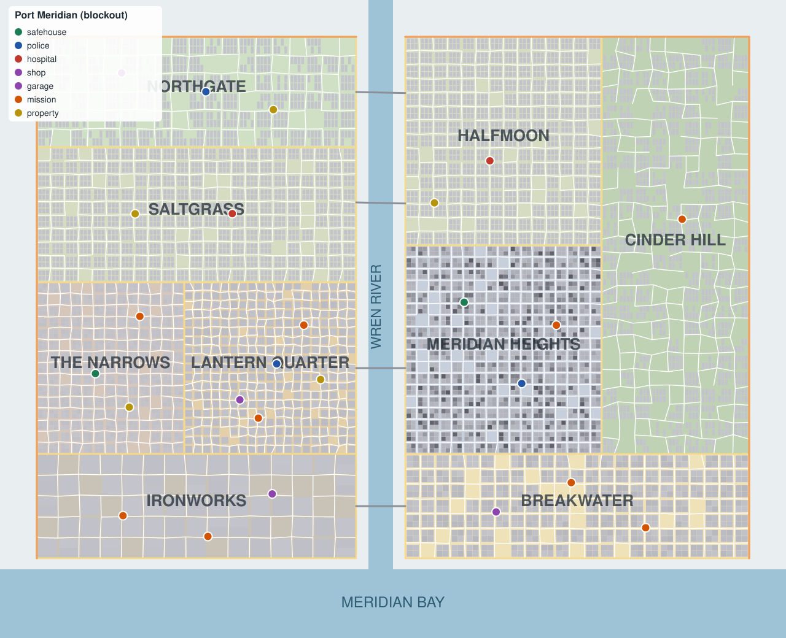

# Undertow

An open-world crime game for Unreal Engine 5, set in the fictional northern port city of **Port Meridian**. Working title; everything here (city, characters, vehicles, weapons) is original.

This repository is the foundation: the game's rules as a tested C++ library, the city and mission data, and an Unreal project that wraps them. It has no art yet. Read [Docs/ROADMAP.md](Docs/ROADMAP.md) before planning around it.



## What is in here

| Part | Where | State |
|---|---|---|
| Simulation core: clock and weather, police heat, road network, ambient traffic, AI driver, police dispatch, missions, economy, bystander reactions, save/load | `Source/Undertow/Sim` | Built and tested here: 12 test suites, gcc and clang with warnings as errors, address and undefined-behaviour sanitizers |
| World data: 9 districts, 2,083 junctions, 371 km of road, 6,808 building masses, 25 locations, 6 missions, economy, vehicles, weapons, tuning | `Content/Data`, generated by `Tools/build_data.py` | Generated and validated by 10 data checks |
| Unreal layer: subsystem, character, vehicle, AI driver component, traffic and police manager, weapon, HUD base, city blockout, mission actors | `Source/Undertow/Game` | **Written but never compiled.** There is no Unreal Engine in the environment it was written in. It passes a static checker for common build-breakers, which is not the same thing |
| Headless simulation | `Tools/sim/ut_sim.cpp` | Runs the real city for N minutes and prints pacing per minute |

## How it fits together

The game's rules do not depend on Unreal. `Source/Undertow/Sim` is plain C++17 with no engine headers, so it compiles and runs anywhere. Unreal compiles the same files as part of the game module, and the classes in `Source/Undertow/Game` are a thin bridge:

```
player pawn ──state──▶ UUndertowSimSubsystem ──tick──▶ ut::Simulation ──events──▶ HUD, traffic actors, police cars
```

That split is why most of the game logic could be tested without the engine, and why a rules change can be checked in seconds here before trying it in the editor.

## Build and test the core (no Unreal needed)

```bash
cmake -S . -B build && cmake --build build -j && ctest --test-dir build --output-on-failure
python3 -m pytest                       # data checks and the Unreal source checker
./build/ut_sim Content/Data 12 1        # 12 simulated minutes, seed 1
python3 Tools/build_data.py             # regenerate the city, missions, economy and map
```

## Open it in Unreal

Follow [Docs/PORTING.md](Docs/PORTING.md). Expect the first compile of `Source/Undertow/Game` to need fixes.

## Documents

- [Docs/DESIGN.md](Docs/DESIGN.md): the game, the city, the cast, how each system plays
- [Docs/PORTING.md](Docs/PORTING.md): step by step from clone to driving around the blockout
- [Docs/ROADMAP.md](Docs/ROADMAP.md): what exists, what is missing, and a realistic order to build it in
